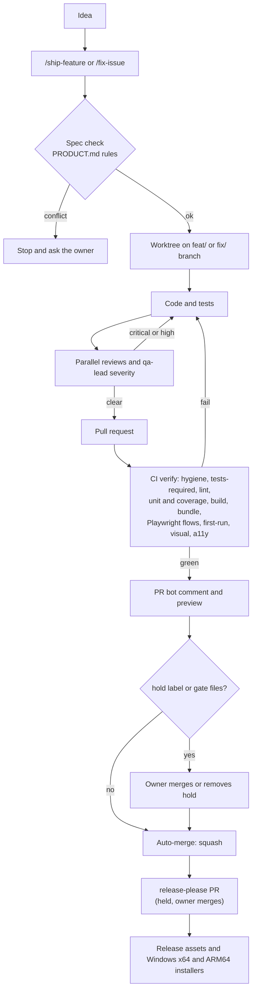

# Pipeline

From an idea to a signed-off release, with almost nothing for the owner to do. Day-to-day usage is in [FEATURE_WORKFLOW.md](FEATURE_WORKFLOW.md); the rules it enforces are in [PRODUCT.md](PRODUCT.md) and [CONTRIBUTING.md](../CONTRIBUTING.md).

Parts of this are being implemented (PR bot, Playwright suites, scheduled jobs). This page describes the design; workflow files in `.github/workflows/` are the source of truth for what is live.

## What you do

| Step | You |
| --- | --- |
| Describe the feature | `/ship-feature <plain language>` or `/fix-issue <n>` |
| Look at the preview | Read the PR bot comment; `npm run preview:branch -- "#<n>"` for the real thing |
| Say "ship it" or stop | Do nothing to ship; add the `hold` label to stop |
| Merge release PRs | Read the changelog, merge the release-please PR |
| Approve owner decisions | Answer when an agent stops on an open decision, a new cost or a new outbound host |

## What runs automatically and when

| What | When | Does |
| --- | --- | --- |
| PR CI (`verify` job) | Every PR push (a newer push cancels the older run) | Hygiene checks (the old `hygiene.yml`, merged into `ci.yml`, not removed), tests-required, lint, affected unit tests (`vitest --changed <base sha>`) with changed-file coverage, build, bundle budget, Playwright (flows, first-run, visual, a11y) |
| Main CI (`main-unit` x3, `main-build`) | Every push to `main` except docs-only ones, and a `workflow_dispatch` of `ci.yml` on `main` with `mode=full` (the PR bot starts one after each merge) | Whole suite in 3 shards, lint, build. No Playwright, never cancelled. The PR bot ignores it (it only reads runs of `pull_request` events) |
| PR bot | After CI and on label or description edits | Updates the sticky comment (including the names of visual snapshots that differ, read from the failed `verify` job annotations), squash-merges when green unless `hold` or gate files |
| Weekly flaky run | Sundays, only if `main` changed | Repeats the test suite 3 times, files or updates a "Flaky tests on main" issue |
| Weekly full Playwright | Sundays (same workflow) | Full Playwright run on `main` |
| Weekly branch cleanup | Weekly | Deletes merged branches (merged more than 2 days ago) |
| release-please | Daily, and on human merges | Opens or updates the release PR (labelled `hold`) and starts `ci.yml` with `mode=full` on its branch (hygiene included) |
| Release build | On a merged release PR | Zip, checksums, and Windows x64 and ARM64 installers |
| Dependabot | Monthly | Update PRs; patch and minor npm updates auto-merge when green, majors get `hold` |

A bot merge made with `GITHUB_TOKEN` fires no `push` event, so the `merge` job of `pr-bot.yml` runs `gh workflow run ci.yml --ref main -f mode=full` after a successful merge (a `workflow_dispatch` may be started with `GITHUB_TOKEN`). On `main` that mode runs the sharded main jobs, which is cheaper than the full `verify` job. The `merge` job is the only job with `actions: write`. A human push to `main` runs the same jobs.

### Which unit tests a PR runs

`scripts/ci/changeKinds.js` decides, `scripts/ci/runUnitTests.js` builds the Vitest command, and both are unit-tested in `server/__tests__/ciPipeline.test.js`.

- Normal code PR: `vitest run --changed <PR base sha>` (tests whose import graph touches a changed file), plus the always-run list (tests that scan the repo and have no import edge).
- Whole suite instead: a removed or renamed `src/` or `server/` JS file (`--changed` cannot find the importers of a module that no longer exists), a change to `package.json` or the lockfile, `vitest.config.js`, `vite.config.js`, anything under `__tests__/setup` or `__tests__/helpers`, `src/test-utils/`, `server/db/`, `server/ai/index.js`, `server/netPolicy.js`, `scripts/` (including `scripts/ci/`), a non-JS file under `src/` or `server/`, more than 40 changed source files, a Dependabot PR, or a manual run (no PR base).
- Docs-only PRs skip the heavy steps inside the job, so the required check still completes.

### Artifacts

Account-wide artifact storage is limited, so every upload is short-lived: CI artifacts (`playwright-report`) keep 1 day and the PR preview `web-dist` keeps 3 days (it is uploaded for pull requests only). `flaky.yml` artifacts keep 1 day. The release path adds none; `ciPipeline.test.js` checks this. New visual baselines are not an artifact: see the next section.

### Visual baselines without an artifact

The `visual-update` mode of `ci.yml` runs in its own job, `visual-baselines`, so the PR `verify` job keeps `contents: read` (it skips itself in this mode). It is the only job with `contents: write`, and it runs only for `workflow_dispatch` with `mode=visual-update`. A separate job is the least privilege that works: it renders in the same pinned Playwright image as `verify`, and a job-level `permissions` block cannot depend on the event, so raising it inside `verify` would give the PR check write access too. Its checkout keeps no credentials (`persist-credentials: false`): the token is not on disk while branch code runs, and exists only in the env of the final push step, which passes it to git as a one-off `http.extraheader` (hooks disabled). `npm ci` there still runs with `--ignore-scripts`.

The job refuses `main`, `release-please--*` and `dependabot/*` branches and non-branch refs, renders the baselines, fails unless every staged path matches `e2e/__screenshots__/**/*.png`, commits as `github-actions[bot]` and pushes one new branch, `ci/visual-baselines-<run id>`, from the dispatched ref's HEAD. The branch name is in the step summary. Nothing is pushed when no baseline changed. A push with `GITHUB_TOKEN` starts no workflow.

Flow:

1. Dispatch: `gh workflow run ci.yml --ref <your branch> -f mode=visual-update` (or `npm run test:visual:update -- --ci`, which does all the steps below except the commit).
2. Fetch the side branch: `git fetch origin ci/visual-baselines-<run id>`.
3. Copy the PNGs into your PR branch: `git checkout origin/ci/visual-baselines-<run id> -- e2e/__screenshots__`, review them, commit and push.
4. Delete the side branch: `git push origin --delete ci/visual-baselines-<run id>`.

## What stays manual

- macOS and Linux desktop builds (run `release.yml` by hand with `desktop` ticked).
- `npm run eval:ai` (needs a real local Ollama; see [EVALS.md](EVALS.md)).
- Enabling the website deploy (own repo, hosting account and token first).
- The code signing decision (open decision 2 in [PRODUCT.md](PRODUCT.md)); installers stay unsigned until then.
- Visual baseline updates (`npm run test:visual:update`, or the `visual-update` CI mode, reviewed by the owner).
- Merging PRs that touch gate files (`.github/**`, `scripts/ci/**`, `scripts/checks/**`, `scripts/release|desktop|license/**`, `src-tauri/tauri*.json`, `capabilities/`, `src/`, `Cargo.toml` and `build.rs`, `config/**`, `Dockerfile`, `compose*.y*ml`, shared test setup and helpers, `scripts/lib/fakeOllamaServer.js`, test and release config), every PR that changes more than 200 source files, every PR with a used `no-tests-needed` waiver, and every release PR.

## Actions minutes

Private repo, Linux runners at 1x. Durations are wall-clock minutes of successful runs from `gh run list -R ChristianMunoz31/burrow --json name,event,createdAt,updatedAt,conclusion -L 200` (CI on a PR 7.3, CI on a main push 7.9, Hygiene 1.2 on a PR and 1.0 on a main push, release-please push 0.6 median, Desktop check 4.2, release assets 8 to 14); rows marked "est." have no run data yet and are replaced by a measurement after the first main push. Usage assumed per month: 60 PR pushes, 30 main pushes (20 percent of them docs-only), 1.5 releases at about 90 billed minutes, a weekly flaky run, about 4 Dependabot runs.

| Item | Per month | Main today (CI + Hygiene separate) | Branch as handed over (nightly flaky, no main CI) | This PR |
| --- | --- | ---: | ---: | ---: |
| PR push: CI (hygiene folded in) | 60 | 60 x (7.3 + 1.2) = 510 | 60 x 7.3 = 438 | 60 x 7.3 = 438 (the `--changed` saving is not claimed until measured) |
| Main push: tests, lint, build | 30 (24 not docs-only) | 30 x (7.9 + 1.0) = 267 | 0 | 24 x 9.5 (est.: 3 shards x about 2.2 + lint and build about 3) = 228 |
| release-please (push and daily) | 60 | 60 x 0.6 = 36 | 36 | 36 |
| Flaky vitest (3 runs, skipped when `main` is unchanged) | 30 nightly, 4 weekly | 0 (manual only) | 30 x 5.8 (est.) = 174 | 4 x 5.8 = 23 |
| Weekly full Playwright | 4 | 0 | 4 x 7 (est.) = 28 | 28 |
| PR bot (status and merge jobs, about 1 billed minute each) | about 105 | 0 | 105 | 105 |
| Releases | 1.5 | 135 | 135 | 135 |
| Desktop check, branch cleanup, Dependabot | | about 18 | about 22 | about 22 |
| **Total** | | **about 966** | **about 938** | **about 1,015** |

What changed in this PR against the branch as handed over: weekly instead of nightly flaky saves about 151 minutes, and the sharded main CI adds about 228 (main was not tested after a merge before). Sharding costs about 1.6 more billed minutes per push than one job (about 9.5 against 7.9) and cuts the wall time of a main run from about 8 to about 4 minutes. Add 10 to 15 percent for failed and re-run pushes: about 1,120 to 1,170, under the 1,200 target. The owner's rough figure for the branch was about 1,310; this table uses measured durations instead, so only the 151-minute flaky saving is comparable. The biggest levers left are the Playwright steps on PRs (visual and a11y only run when the UI changes) and the release (about 135).

## The tests waiver

The `coverage (changed files)` step fails below the 60 percent floor (or when no coverage summary exists) and never reads the waiver, so a stale green step cannot hide a low-coverage PR. The PR bot decides live: it accepts that one failure only when the `no-tests-needed` label is on the PR and the description has a `No tests needed because: <reason>` line, and then it never auto-merges: the owner merges. The label only counts when the repo owner applied it (the `labeled` event actor in the issue timeline); a label applied by anyone else, including a workflow token, is ignored. The check identifies the GitHub account, so an agent running `gh` with the owner's login would look like the owner: `/ship-feature` forbids adding the label and asks the owner instead. Only the repo owner is a trusted PR author (plus Dependabot by login). A PR with more than 200 changed source files skips the coverage floor with a note, because coverage is not measured per file there, and the bot never auto-merges it: the owner merges.

## Accepted risks

- `PERSONAL_DENYLIST` (an optional secret with private terms) is available to the `hygiene: personal data` step, which runs on PR head code. A malicious same-repo PR could print it. Accepted: the repo is private, the owner is the only author, and the bot never auto-merges gate files (changes to `.github/**`, `scripts/checks/**` and the other gate files always need the owner's own merge).
- In `visual-baselines`, steps in the same container could tamper with files before the push step runs. Mitigated by the PNG-only staged path check and by refusing `main`, release and Dependabot refs.
- PR test code runs in the `verify` job before the coverage script. This is inherent to running a PR's tests; only the owner and Dependabot author PRs.
- The owner-applied waiver check trusts the GitHub account, not the person or agent behind it (see above). Accepted for a private repo with a solo owner.
